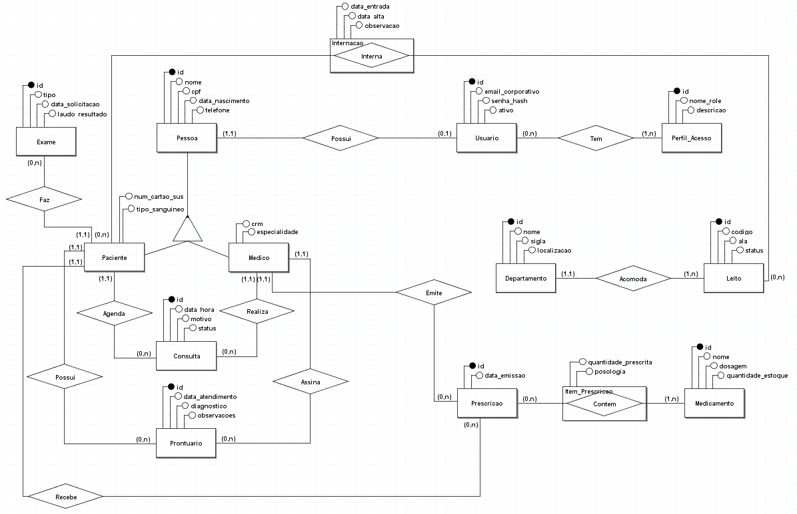
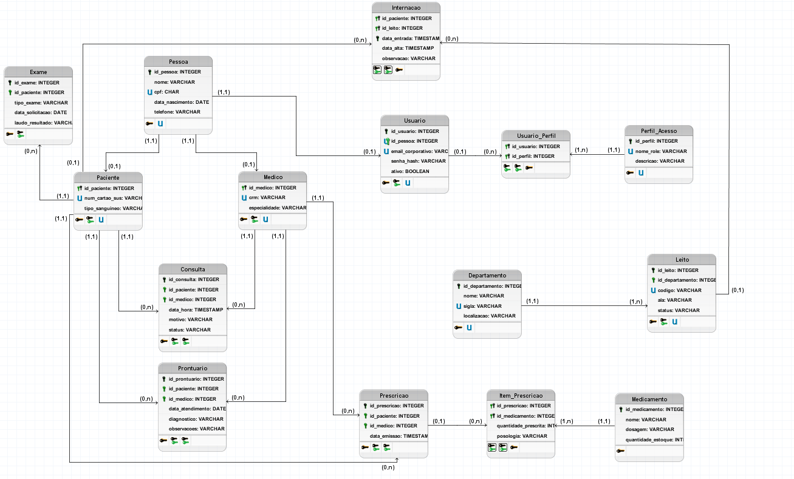

## 📃 Sobre o Projeto
Este repositório reúne a documentação da modelagem de banco de dados relacional desenvolvida para a disciplina de Banco de Dados I do curso de Análise e Desenvolvimento de Sistemas (ADS).

O esquema foi arquitetado para simular o ecossistema de um ambiente hospitalar real, aplicando na prática conceitos fundamentais da disciplina.

## 🏥 O que o sistema modela

O banco organiza dados de pacientes, médicos e usuários, incluindo perfis de acesso. Também representa departamentos e leitos, consultas e internações, além dos registros clínicos associados aos atendimentos. Para apoiar o acompanhamento dos pacientes, o modelo contempla exames, prescrições médicas, medicamentos e o controle de estoque.

## 🛠️ Tecnologias e escopo

- **Tecnologias:** modelagem relacional, SQL e PostgreSQL.
- **Escopo:** projeto acadêmico que documenta a estrutura lógica de um banco de dados hospitalar, incluindo entidades, atributos e relacionamentos. 

## ⚙️ Como executar

### Pré-requisitos

- PostgreSQL instalado e em execução.
- pgAdmin conectado ao servidor PostgreSQL.

### Criar o banco

No pgAdmin, conecte-se ao servidor PostgreSQL, selecione o banco `postgres` e abra **Tools → Query Tool**. Verifique se **Auto-commit** está ativo e execute:

```sql
CREATE DATABASE gerenciamento_hospitalar;
```

### Aplicar o esquema

Atualize a lista de bancos no pgAdmin, selecione `gerenciamento_hospitalar` e abra **Tools → Query Tool**. No Query Tool, abra `sql/01_ddl_schema.sql` pelo botão **Open File**, então execute o conteúdo com **F5**. O script cria as tabelas e restrições do esquema.

Para conferir as tabelas, atualize **Schemas → public → Tables** no navegador do pgAdmin.

## 📚 Documentação

- [Esquema relacional](docs/esquema_relacional.md)
- [Descrição textual do sistema](docs/descricao_textual.md)

## 🧩 Diagramas do modelo

### Diagrama Entidade-Relacionamento (DER)



### Diagrama lógico



## 📂 Conteúdo do repositório

- **`sql/01_ddl_schema.sql`** — cria as tabelas, chaves e restrições do banco de dados.
- **`sql/02_dml_seed.sql`** — insere dados de exemplo para explorar o modelo.
- **`.gitattributes`** — configura o GitHub para incluir arquivos SQL nas estatísticas de linguagens do repositório.
- **`docs/der-sistema-hospitalar.png`** — diagrama entidade-relacionamento conceitual do sistema.
- **`docs/dl-sistema-hospitalar.png`** — diagrama lógico com tabelas, atributos e relacionamentos.
- **`docs/esquema_relacional.md`** — descreve textualmente as entidades, atributos e relacionamentos.
- **`docs/descricao_textual.md`** — apresenta o sistema e seus requisitos de dados.

## 📋 Regras de negócio

- Pessoas podem ser cadastradas como pacientes ou médicos. Pessoas autorizadas podem ter uma conta de usuário vinculada.
- Um usuário pode receber vários perfis de acesso, e cada perfil pode ser atribuído a vários usuários.
- Cada consulta relaciona um paciente e um médico e registra data e hora, motivo e status.
- Os prontuários registram o atendimento do paciente pelo médico, com data, diagnóstico e observações.
- Um paciente pode ter várias internações ao longo do tempo. Cada internação relaciona o paciente a um leito e registra datas de entrada e alta e observações.
- Leitos pertencem a departamentos e possuem um status, como livre ou ocupado.
- Exames são associados a pacientes e guardam tipo, data da solicitação e laudo ou resultado.
- Médicos emitem prescrições para pacientes. Cada prescrição pode conter vários medicamentos; cada item registra quantidade e posologia.
- O estoque de medicamentos é acompanhado pela quantidade disponível.

## 👥 Créditos

Projeto acadêmico desenvolvido por **Thales Santos** para a disciplina de Banco de Dados I do curso de Análise e Desenvolvimento de Sistemas (ADS).
